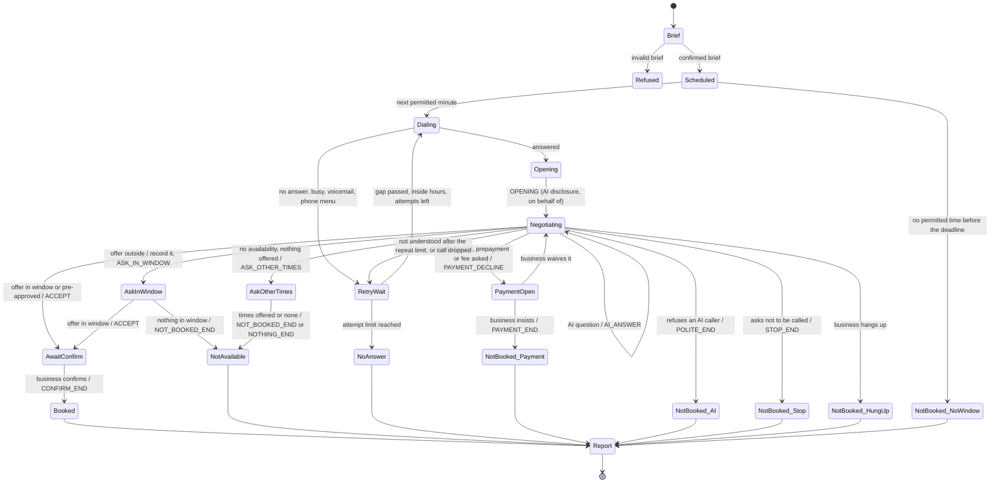

# Call-for-Me Booking agent: design

Issue #79, design and simulation stage for NEAR Agent Market job 92332aa9-7f29-40f2-b173-909d6defed1f ("Call-for-Me Booking Agent", bid pending at 400 USDC). This stage places no calls, opens no telephony account and spends nothing. Live calling is an owner decision at award time.

Reconciled against the job description and the bid proposal as the coordinator posted them verbatim on issue #79 (comments 6366189256 and 6366189929). Their stated lengths and sha256 values were re-checked from the GitHub API copy of those comments: 9064 characters, `1d72db98…ddb26`, and 1653 characters, `7a251a6e…7c148`.

## 1. Inputs and the confirmed brief

The job's minimum input is the business, the date and time window, party size or service, the booking name, and any acceptable alternatives. The brief adds what the rules need to be checked before any call:

| Field | Why |
| --- | --- |
| `business.name`, `business.phone` (+1, E.164) | who to call; operating country is the United States only |
| `business.phone_source` | the page where the business itself publishes the number. Rule: call business numbers only, never private individuals |
| `business.timezone`, `business.opening_hours` | calls happen only during opening hours, in the business's local time |
| `booking.date`, `booking.start`, `booking.end` | the window; nothing outside it is accepted |
| `booking.party_size` or `booking.service` | exactly one of the two |
| `booking.name` | the name the booking is held under |
| `alternatives` | pre-approved windows; the only times outside the main window that may be booked |
| `callback_number` (optional) | given to the business only when the buyer put it in the brief |
| `special_requests` (optional) | answered when the business asks |
| `report_language` | `en` only in this build |

Validation fails closed. Any field whose name looks like payment data, such as card, deposit or billing, is refused, so the agent never holds payment details to give. `check --brief FILE` prints the confirmed brief, the job's "confirmed brief before any call".

## 2. Architecture

Two layers, so a hard rule never depends on how well speech was understood:

- **Understanding** turns one business utterance into intents and offered slots: `understand()` in `call_for_me.py`. Here it is a small rule set, enough for scripted scenarios. At the live stage it becomes real-time speech recognition feeding a classifier, with the same output shape.
- **Policy** is `CallSession`. It speaks only the fixed templates below and decides every booking itself. It accepts a slot only when the date is known and exactly one reading of the time falls inside the window or a pre-approved alternative. It treats a booking as made only when the business confirms after the agent's read-back. It stores structured fields only.

A time stated without am or pm, such as "7:30", is accepted only when exactly one reading falls in the window. The acceptance line reads the date and time back in full, so the business confirms the exact slot.

The phone line is an interface with one method, `dial(number, at)`. The only implementation in this build is `ScriptedLine`, the simulation's scripted business. `call` always refuses.

## 3. Call state machine

Within one business turn the policy runs its steps in a fixed order:

1. stop requests and refusals of an AI caller
2. the AI question
3. payment requests
4. offered times
5. standard questions: name, party size, service, callback number, special requests
6. confirmation
7. the nothing-in-the-window path
8. hold, goodbye, or not understood

Because the order is fixed, an utterance carrying several intents cannot skip a rule. "Is this a robot? We need a card" gets both answers, in that order.

## 4. Exact wording

Every line the agent speaks is one of these templates. Fields in braces come from the confirmed brief or from the slot being read back.

| Template | Text |
| --- | --- |
| `OPENING` | Hello, this is an automated booking assistant, an AI, calling on behalf of {name}. I'd like to book {what} on {window}. |
| `AI_ANSWER` | Yes, I am an AI. I'm an automated booking assistant calling on behalf of {name}. |
| `AI_CONTINUE` | I'd still like to book {what} if that's all right with you. |
| `POLITE_END` | I understand. Thank you for your time, goodbye. |
| `STOP_END` | Understood, we won't call again. Goodbye. |
| `PAYMENT_DECLINE` | I'm not able to give card details or agree to a deposit, prepayment or cancellation fee. I'll pass the request on to {name}. Can the booking be made without it? |
| `PAYMENT_END` | Understood. Then please don't book it, and I'll let {name} know about the request. Thank you, goodbye. |
| `ACCEPT` | That works. Please book {what} on {date} at {time} under the name {name}. |
| `ASK_IN_WINDOW` | Thank you. I can only book {allowed}. Is anything available in that time? |
| `ASK_OTHER_TIMES` | Do you have any other times you could offer? I won't book them now, I'll pass them on. |
| `ASK_DATE` | Sorry, which day is that for? |
| `NOT_BOOKED_END` | Thank you. I won't book anything now, and I'll pass the times you offered on to {name}. Goodbye. |
| `NOTHING_END` | Thank you for checking. I won't book anything now. Goodbye. |
| `GIVE_NAME` | The name is {name}. |
| `GIVE_PARTY` | It's for {party} people. |
| `GIVE_SERVICE` | It's for {service}. |
| `GIVE_CALLBACK` | The callback number is {callback}. |
| `NO_CALLBACK` | I'm not able to share a phone number. Could the booking be held under the name {name}? |
| `GIVE_REQUESTS` | One request: {requests}. |
| `NO_REQUESTS` | No special requests, thank you. |
| `REPEAT` | Sorry, could you say that again? |
| `UNCLEAR_END` | I'm sorry, I'm having trouble understanding. I'll try again later. Goodbye. |
| `WAIT` | Of course, I'll hold. |
| `ASK_TIME` | Sorry, which time is the booking for? |
| `CONFIRM_END` | Thank you. So that's {what} on {date} at {time} under {name}{ref}. Goodbye. |

**Disclosure.** `OPENING` is always the first line on every answered call. It says the caller is an automated booking assistant, an AI, calling on behalf of the named customer, so disclosure is upfront wherever law requires it. When asked whether it is an AI, a robot, a machine, a recording or a real person, with or without a question mark (speech recognition output often has none), it always answers with `AI_ANSWER`: "Yes", plus who it is calling for. It then asks to continue with `AI_CONTINUE`. If the business refuses to deal with an AI, it ends with `POLITE_END` and does not retry.

## 5. Alternatives logic

- A slot is bookable only if its date is known and exactly one reading of its time lies inside the main window or inside one pre-approved alternative. Window ends are inclusive.
- A bookable slot gets `ACCEPT`, with a full read-back. It is booked only when the business confirms. If the business confirms a different time that is outside the window, nothing is booked and that time is recorded as an alternative.
- Every other offered time is recorded as an alternative, with the date, the resolved time and the exact words of the slot as stated (for example "Saturday at 2:30 pm"). It is never booked. The agent asks once whether anything inside the window exists (`ASK_IN_WINDOW`). If not, it ends with `NOT_BOOKED_END`, which is the bid's answer to "only table left is outside the requested time".
- If the business has nothing and offers nothing, the agent asks once for other times (`ASK_OTHER_TIMES`) so the report can list them, then ends.
- A booking made inside a pre-approved alternative is flagged in the report: "This booking uses one of the pre-approved alternatives from the brief", as the bid promises.
- Weekday names resolve to the date nearest the requested date with that weekday, never before the day of the call. An unknown date triggers `ASK_DATE` once and is never booked.

## 6. Payment refusal path

Any mention of a card, card details, a deposit, prepayment, paying upfront, or a cancellation or no-show fee triggers `PAYMENT_DECLINE`. The agent gives nothing, agrees to nothing, says it will pass the request on, and asks whether the booking can be made without it. While that question is open, an offered slot is held back and not accepted.

- If the business waives the condition, the held slot gets `ACCEPT` and the call continues.
- If it insists, the agent ends with `PAYMENT_END`. The report shows status "not booked", reason payment required, what was asked for, and the slot that was offered only with that condition.

The report never asks the buyer for payment details. It tells the buyer to contact the business directly if they want to proceed. This covers the fail signal "Gives, or asks the buyer for, payment information".

## 7. Retry limits and calling hours

| Setting | Value | Stated in the listing |
| --- | --- | --- |
| Attempts per business per job, first call included | 3 | yes |
| Minimum gap between attempts | 30 minutes | yes |
| Calling hours, business local time | 09:00 to 20:00, and only inside the business's opening hours | yes |
| Last call | 60 minutes before the booking window opens | yes |
| Ring timeout (live stage) | 30 seconds | no |
| Call time limit (live stage) | 600 seconds | no |
| "Could you say that again" per call | 2 | no |

Retried: no answer, busy, voicemail, an automated phone menu that blocks the call, a call that drops, and a call the agent could not understand. Not retried: booked, not available, payment required, the business declined an AI caller, the business hung up, and the business asked not to be called again. The job's limitations say such refusals are outcomes to report, not to retry. The values above are the owner's to confirm at award. The code reads them from one `POLICY` table, so the listing and the behaviour cannot drift apart.

## 8. Structured outcome fields

The report is rendered only from this record. No business speech is stored in it.

| Field | Content |
| --- | --- |
| `status` | `booked`, `not available`, `no answer`, or `not booked` |
| `reason` | for `not booked`: `payment_required`, `declined_ai_caller`, `hung_up`, `asked_not_to_call`, `unclear` or `no_call_window` |
| `booking` | date, time, name, party size or service, confirmation number if given, and whether a pre-approved alternative was used |
| `requested` | the confirmed brief's window, name, party size or service, and alternatives |
| `alternatives_offered` | per offer: date, time, the slot's words as stated, booked: false |
| `payment_requests_declined` | card details, deposit, prepayment or cancellation fee |
| `offered_only_with_payment` | a slot the business would hold only with a payment condition |
| `callback` | whether the business asked for a number and whether the brief's number was given |
| `attempts` | every attempt: number, UTC and local time, result, how it ended, AI disclosed at start, times asked if AI, times answered yes |
| `kept` | the statement of what was kept |

## 9. No recording, no transcript

- The agent keeps the structured record above and nothing else. `CallSession` stores template ids, never text. The business's words are read once and dropped. The tests check that no business sentence appears in the session state or in the outcome.
- At the live stage, provider recording stays off: Twilio `Record` defaults to `false`, and Telnyx recording is disabled by default. Real-time recognition is used. Any recording the provider creates is deleted through the API, which both providers document (see PROVIDERS.md). Whether the provider itself retains real-time transcription text is not stated in either spec. It stays an open item until the pages named in PROVIDERS.md are captured. The live stage must not start before that is answered.
- The simulation's `ScriptedLine` keeps the scripted dialogue so a reviewer can read it with `--dialogue`. That is the test harness's synthetic script, labelled as such in its output, not something the agent keeps.

## 10. Acceptance criteria

Each criterion is quoted from the job description, followed by how the design meets it and what proves it here.

**Criterion 1.** "Given a complete brief, it books a time inside the requested window, and the report's details (date, time, name, party size or service) match what was agreed on the call."
The agent accepts only an in-window slot, reads it back, and books only on the business's confirmation. The report's booking row comes from that confirmed slot and the brief. Proved by scenarios 01 and 03, by the exhaustive window test (every quarter hour on three days, with and without am/pm), and by the invariant that a booked status always has a date, time and name inside the window or an alternative.

**Criterion 2.** "When nothing is available in the window, it books nothing outside the buyer's alternatives, and the report lists what the business offered."
Out-of-window offers are recorded with their exact words and never booked, and a pre-approved alternative is booked and flagged. Proved by scenarios 02 and 07, by a test where the business confirms a different out-of-window time, and by the invariant that no offered alternative is marked booked.

**Criterion 3.** "Answers truthfully when asked if it is an AI, and keeps no recording or transcript of the call."
The AI disclosure opens every answered call, and every AI question gets `AI_ANSWER`. The record keeps structured fields only. Proved by scenarios 03 and 05, by the invariants that each attempt opens with the disclosure and that times asked equal times answered yes, by a check that the agent never says it is a person, and by the no-stored-speech checks. The live stage still has the retention open item in section 9.

**Criterion 4.** "When asked for card details or a deposit, it declines and reports the request to the buyer."
The payment path in section 6. Proved by scenarios 04 and 08, and by tests over card, deposit, prepayment and fee wordings, each declined and none accepted while open.

**Criterion 5.** "When there is no answer or the line is busy, it retries no more than the number of times stated in its listing, and the report lists every attempt."
The retry rules in section 7, using the same `POLICY` values the listing states. Proved by scenario 06 (no answer, busy, voicemail, then stop at the limit, with a fourth scripted answer never reached), by the schedule tests, and by the invariant that no attempt falls outside opening or calling hours.

**Criterion 6.** "Every report includes the status, booking details, all attempts, and any alternatives the business offered."
The report always has the status, booking details ("Nothing was booked" when empty), alternatives ("None offered" when empty), every attempt, next steps and what was kept. Proved by a test over every scenario report.

**Criterion 7.** "If the agent offers online booking, it books only through the business's own website, and online bookings meet criteria 1 and 2."
This agent does not offer online booking. It books by phone only, and the listing says so, so the criterion does not apply. It never uses third-party booking platforms.

## 11. Fail signals

| Fail signal (verbatim) | Guard |
| --- | --- |
| Books a time outside the buyer's window or alternatives. | Section 5. The policy decides, not the understanding layer. Exhaustive window test and booking invariant. |
| The report says "booked" but is missing the date, time or name, or the details don't match the call. | The booking row comes from the confirmed slot and the brief. The invariant fails a booked status without date, time and name. |
| Denies being an AI when asked. | `AI_ANSWER` always starts "Yes, I am an AI." No template says otherwise, and the invariant scans every agent line. |
| Gives, or asks the buyer for, payment information. | The brief refuses payment fields, `PAYMENT_DECLINE` gives nothing, and the report never asks the buyer for payment. The invariant scans agent lines for card-like numbers. |
| Keeps a recording or transcript after the job. | Section 9. |
| Books through a third-party booking platform that doesn't allow automated bookings. | No online booking in this agent. |

## 12. Rules for every job

| Rule (verbatim) | Guard |
| --- | --- |
| Call business numbers only, never private individuals. | `business.phone_source` is required: the business's own page publishing the number. At the live stage the number is checked against that page before the brief is confirmed. |
| Do not record or store the call. | Section 9. |
| If asked whether you are an AI, say yes, and say who you are calling for. | `AI_ANSWER` names the customer. |
| Where local law requires telling people upfront that they are talking to an AI, do that. | `OPENING` discloses upfront on every call, everywhere. |
| Never give payment card details or agree to deposits, prepayment or cancellation fees. | Section 6. |
| Never accept a time or service outside the buyer's alternatives. | Section 5. The service is fixed by the brief, and the agent only ever names the brief's service. |
| Never use third-party booking platforms whose terms don't allow automated bookings. | Not used. |

## 13. Open items for the award stage (owner decisions)

- Provider choice, a caller-ID number, and an account. Both are spend, and PROVIDERS.md lists the facts still awaiting capture.
- Confirming that the provider does not retain real-time transcription text (section 9). This blocks live calls until answered.
- Final listing values: attempts, gap, calling hours, and region. Region is the United States per the bid, English only.
- A legal review of automated-call rules for the operating region. These are not provider facts and are not covered here.
- Hosting the webhook endpoint the provider calls back.
- The live understanding layer: recognition engine and classifier, tested against the same scenarios through the same `CallSession` policy.

## 14. Limits of this stage

- Understanding is a rule set written for the scripted scenarios. Real speech will be messier. The policy layer is what enforces the rules, and it is what the simulation tests.
- Calls and reports are in English only, and the operating region is the United States only.
- No telephony, audio, recognition or synthesis was exercised. Every dialogue is SYNTHETIC.
